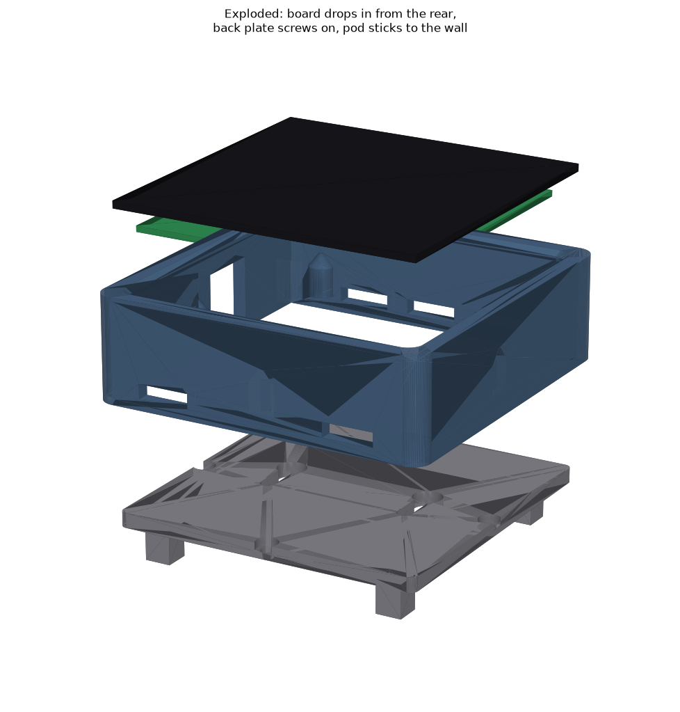
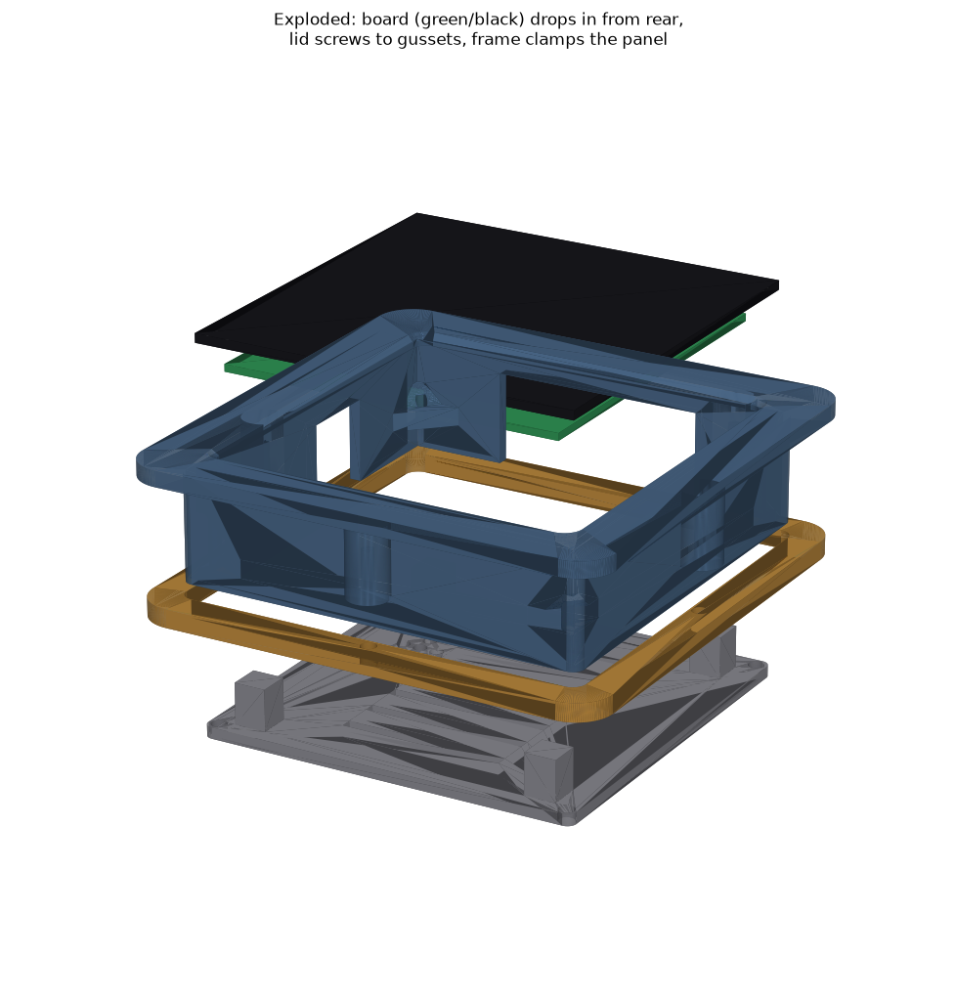

# Printed Housings — Waveshare ESP32-S3-Touch-LCD-4 (V2/REV4)

Two parametric housing variants, generated with build123d. STEP + STL for every
part in `export/`. All dimensions derived from Waveshare's official board STEP
(`esp32-s3-touch-lcd-4_asm.stp`) and dimension drawing — not eyeballed.

| Variant | Script | Use |
|---|---|---|
| **Surface pod** | `pod_housing.py` | Self-contained 92×92×28 box, sticks to any wall with 3M VHB tape (or hangs on 2 keyhole screws). No holes in the boat. **← the V-berth bunk unit** |
| **Flush panel-mount** | `gauge_housing.py` | Classic recessed instrument look; needs a 92×92 panel cutout. Kept for a future helm/nav-station install. |

## Surface pod (`pod_body` + `pod_back`)



- One-piece rounded body; board drops in from the rear, bezel lip retains the
  glass. Back plate screws into four wall-face bosses with 4× **M3×8**
  self-tappers (heads counterbored so the back stays flat). The bosses have
  45° conical lead-ins fused to the walls — no floating first layers, so the
  body genuinely prints face-down with **zero supports** (the earlier corner
  gussets, which had a mid-air first layer, were removed in v2).
- **Mounting**: flat back with a large tape zone — use 3M VHB (e.g. 4910/5952),
  four ~20 mm squares near the corners, avoiding the two keyhole slots. The
  keyholes (Ø8 head pass, 4 mm slots, 40 mm apart) are a screw-hang alternative.
- **Cable**: USB-C exits the left wall through a rear-open notch flush with the
  wall — a **right-angle USB-C cable** sits tidiest. Route it in before
  screwing the back on.
- **Vents**: 3 slots on the bottom wall + 2 on the top wall near the back edge
  (convection + lets the alarm buzzer be heard). `TERMINAL_NOTCH = True` in the
  script adds the 12 V terminal-plug opening if the pod ever runs on boat power.
- Four 7×7 pillars on the back plate land 0.3 mm shy of the board's corner
  standoffs — add thin foam pads there to preload the board.
- Prints: body face-down, back exterior-down; no supports for either.

## Flush panel-mount (`bezel_can` + `clamp_frame` + `rear_lid`)



## Parts

| Part | File | Role |
|---|---|---|
| A | `bezel_can` | Front bezel (106×106, face recessed lip) + through-panel can. Board drops in from the rear; the lip retains the glass with a 1.85 mm overlap (active pixels stay >3 mm clear). |
| B | `clamp_frame` | Slides over the can from behind the panel. 4× M3 screws into the can's side bosses pull it against the panel back. |
| C | `rear_lid` | Vented lid, screws into internal corner gussets. Four 7×7 pillars land 0.3 mm shy of the board's corner standoffs — add a thin foam pad there so the board is preloaded and can't rattle. |

## Panel cutout

- **92 × 92 mm square**, corner radius up to 5 mm OK (jigsaw-friendly).
- Drill four Ø10 mm relief holes for the clamp bosses, centered ~1.5 mm
  *outside* the cutout line at: mid-right edge, left edge 10 mm below center,
  top edge 30 mm right of center, mid-bottom edge (matches `BOSS_XY` in the script).
- Panel thickness is the `PANEL_T` parameter (currently **12 mm**). Measure the
  real bulkhead, edit one line, re-run the script.

## Hardware

- 4× M3×12 self-tapping (clamp frame → boss pilot bores, Ø2.5)
- 4× M3×10 self-tapping (lid → gusset pilot bores, Ø2.5)
- Foam tape: thin strip between bezel flange and panel (seal), small pads on the
  lid pillars (board preload).

## Cable routing

Both openings are rear-open notches — drop cables in, then screw the lid on:
- **USB-C**: left wall notch (17 mm wide). The receptacle sits ~8 mm inside the
  wall, so the whole cable overmold passes through the notch to reach it.
- **Terminal plug**: bottom wall notch (46 mm wide) for the green 3.5 mm plug +
  wires, if the gauge is ever powered from boat 12 V (7-36 V input).

## Printing

- Material: **PETG** (cockpit heat; PLA fine for a desk fit-test print).
- `bezel_can`: bezel face down on the bed. No supports needed — the internal
  gussets have 45° tapered starts.
- `clamp_frame`, `rear_lid`: flat as modeled, no supports.
- Walls 2.5 mm; 3-4 perimeters recommended over infill %.

## Regenerating / editing

```sh
python3.12 -m venv .venv && .venv/bin/pip install build123d
.venv/bin/python gauge_housing.py
```

`export/housing_assembly_boardframe.step` is positioned in the **board STEP's
coordinate frame** — import it together with Waveshare's
`esp32-s3-touch-lcd-4_asm.stp` (in `vendor/waveshare-board-step/`, or from
https://files.waveshare.com/wiki/ESP32-S3-Touch-LCD-4/Esp32-s3-touch-lcd-4_asm.zip)
and they overlay exactly for a fit check in FreeCAD/Fusion.

## Known geometry facts (from the board STEP)

- Glass 84.2×84.2, module max depth 15.0 mm behind the glass face
  (deepest part = terminal block).
- PCB 74.5×76.5 with corner standoffs (rear faces 8.8 mm behind glass front)
  at a 66.5 × 68.5 grid — these are the lid-pillar pressure points.
- USB-C on the left edge, terminal block inset on the bottom, buzzer under the
  lid's grille cluster.
